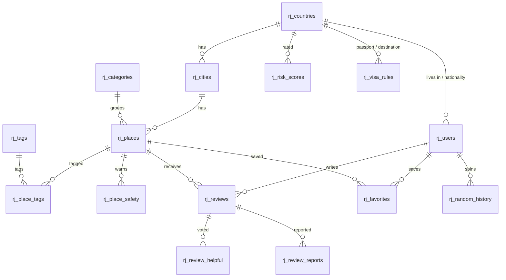

<div align="center">

# 🧭 Random Journey

### Travel Destination Recommender & Random Trip Generator

[](https://angsila.informatics.buu.ac.th/~68160064/RandomJourney/)
[](https://www.php.net/)
[](https://www.mysql.com/)
[](https://leafletjs.com/)
[-555555?style=for-the-badge)](#-design-decisions)

> *Tell it your budget, how much risk you can take and whether you want mountains, sea or old cities —*
> *get ranked recommendations with reasons, or spin for somewhere you'd never have picked.*

| 🌍 Destinations | 🏙️ Cities | 📍 Places | 🗄️ Tables | 🛡️ Risk dimensions | 🧪 Pages crawled |
|:---:|:---:|:---:|:---:|:---:|:---:|
| 5 | 11 | **97** | 21 + 1 view | 6 per country | **616**, 0 errors |

</div>

---

## 📋 Table of Contents

- [✨ Overview](#-overview)
- [🚀 Live Demo](#-live-demo)
- [🧩 Features](#-features)
- [🎯 Recommend vs Random](#-recommend-vs-random)
- [🗄️ Database](#️-database)
- [🔐 Security](#-security)
- [🌐 External Data](#-external-data)
- [📁 Project Structure](#-project-structure)
- [⚙️ How to Run](#️-how-to-run)
- [🛠️ Tech Stack](#️-tech-stack)
- [🧠 Design Decisions](#-design-decisions)
- [🔮 Future Work](#-future-work)
- [📖 Credits & Data Sources](#-credits--data-sources)

---

## ✨ Overview

**Random Journey** is a travel website built as coursework at **Burapha University**, running on the faculty's **Angsila** server with its MySQL database. It covers five destinations chosen to spread across every filter — popular, historic and natural, cheap and expensive, low and higher risk:

| Country | Cities | Why it's in the dataset |
|---|---|---|
| 🇹🇭 Thailand | Bangkok, Chiang Mai, Krabi | Temples, mountains *and* islands; home country of the author |
| 🇯🇵 Japan | Tokyo, Kyoto | Lowest risk, high cost, shrines and modern cities |
| 🇮🇹 Italy | Rome, Florence | Ancient Rome and Renaissance art; pickpocket hotspot |
| 🇪🇬 Egypt | Cairo, Luxor | Pharaonic sites in the desert; cheapest destination |
| 🇵🇪 Peru | Cusco, Lima | Machu Picchu, high-altitude trails, Pacific coast |

### What makes this project stand out

- 🎯 **Two discovery modes with a real difference** — *Recommend* ranks places by a weighted match score and explains every result; *Random* treats filters as hard limits and adds chance, locks and a whole-day trip.
- 🛂 **Personalised by passport** — the visa panel, the "easy visa" filter and price conversion all use the nationality and currency in the user's profile.
- 🛡️ **Risk split into 6 dimensions** — petty crime, violent crime, natural hazards, health, unrest and road safety, each with *how to handle it*, plus place-specific safety tips.
- 🌦️ **Live data that degrades gracefully** — weather and exchange rates are cached in MySQL; if an API is down, pages fall back to stale data and never slow down.
- 🧰 **One admin engine for every content type** — cities, places, risks, visas and tips are each described once and get list, search, filter, create, edit and delete for free.
- 🔐 **Security by default** — Argon2id passwords, prepared statements everywhere, CSRF on every form, login rate limiting and a strict Content Security Policy.

---

## 🚀 Live Demo

### 👇 Try it now

**https://angsila.informatics.buu.ac.th/~68160064/RandomJourney/**

> ⚠️ **Note:** Angsila is a university server. If the link doesn't load from outside campus, connect through the BUU network or VPN.

| Page | What to try |
|---|---|
| **Destinations** | Open a country to see visa rules, the 6-part risk meter, cost of living and emergency numbers |
| **Recommend** | Pick *History* + *Ancient Site*, set risk to *Low*, mark Themes as *Must have* |
| **Spin** | Choose *A whole day*, spin, then press *Keep this city, spin again* |
| **A place page** | Map, distance from the city centre, nearby places, weather, reviews, ♡ Save |

---

## 🧩 Features

| # | Requirement | How it's implemented |
|:-:|---|---|
| 1 | Login with hashed passwords | `password_hash()` with **Argon2id**, automatic rehash, lockout after 5 failed logins |
| 2 | Admin panel | Dashboard with content-gap checks and API status · CRUD for destinations, cities, places, safety tips, risks, visas · user roles & suspension · review moderation |
| 3 | User profile with country & nationality | Residence, nationality and display currency drive visa info and price conversion |
| 4 | Database | 21 tables + 1 view on MySQL 8.0, foreign keys, CHECK constraints, cached ratings |
| 5 | Travel information | Places in 10 categories (attractions, trails, restaurants, cafés, sit-down bars, markets, malls, souvenirs, hotels) with history, culture & beliefs, prices, opening hours, dress code, permits, map, distance, weather, exchange rates, cost of living, risks & safety tips, visa rules |
| 6 | Recommendation system | Weighted score from 7 criteria with user-chosen importance, plus a list of reasons per result |
| 7 | Random system | Hard filters, single place or whole-day trip, lock country/city, avoids recent repeats, spin history |
| 8 | User reviews | 1–5 stars, edit/delete own review, *Helpful* votes, reports, admin hide/restore |
| 9 | Extras | ♡ Saved places, weather-based packing tips, emergency numbers, "which filter is blocking you" hint |

---

## 🎯 Recommend vs Random

|  | 🎯 **Recommend** | 🎰 **Random** |
|---|---|---|
| Goal | Find the **best fit** | Find something **unexpected** or break a tie |
| Filters | Set a value **and** how much it matters | Every filter is a **hard limit** |
| Output | Ranked list with **% match** and reasons | One place, or a full day: *See · Eat · Shop · Sleep* |
| Extras | Map of the top 10 | Slot-machine reveal, lock country/city, no recent repeats |

### Match score

Each criterion $i$ the user sets gets an importance $w_i \in \{0, 1, 2, 3\}$ (*Doesn't matter*, *Nice to have*, *Important*, *Must have*) and a match $m_i \in [0, 1]$:

$$
\text{score} = 100 \times \frac{\sum_i w_i \, m_i}{\sum_i w_i} \;+\; \underbrace{2.5\,(\bar{r} - 3)}_{\text{rating nudge, }\pm 5}
$$

| Criterion | Match $m_i$ |
|---|---|
| Budget | 1 if within the price level, −0.35 per level over |
| Safety | 1 if the country's overall risk ≤ limit, −0.4 per point over |
| Cost of living | 1 if at or below the chosen level, −0.35 per level over |
| Themes | share of chosen tags the place has |
| Landscape | 1 on match, 0.7 for sea ↔ island |
| City or nature | 1 on match, 0.6 for *mixed* places |
| Easy visa | 1 if home country, visa-free, on arrival or e-Visa |

*Must have* criteria are applied as filters before scoring. The overall country risk is a weighted average computed by the view `rj_v_country_risk` (violent crime 25%, unrest 20%, petty crime / natural / health 15% each, traffic 10%).

---

## 🗄️ Database

All tables use the `rj_` prefix so the project can share a database with other coursework.



| Group | Tables |
|---|---|
| Geography | `rj_countries` (all 249 countries, 5 flagged as destinations), `rj_cities` |
| Places | `rj_places`, `rj_categories`, `rj_tags`, `rj_place_tags` |
| Safety & entry | `rj_risk_scores`, `rj_place_safety`, `rj_visa_rules`, view `rj_v_country_risk` |
| Users | `rj_users`, `rj_login_attempts` |
| Community | `rj_reviews`, `rj_review_helpful`, `rj_review_reports`, `rj_favorites`, `rj_articles`, `rj_article_places` |
| System | `rj_random_history`, `rj_api_cache`, `rj_transport_routes` |

---

## 🔐 Security

| Threat | Protection |
|---|---|
| Stolen password database | Argon2id hashes, rehashed automatically when parameters change |
| Brute-force login | 5 failures per username or 20 per IP in 15 minutes → temporary lock |
| Username enumeration | Same error message for every failure, and a dummy hash check so timing is equal |
| SQL injection | PDO prepared statements with emulation off; table/column names only come from code |
| XSS | Every output passes through `e()`; strict Content-Security-Policy with no inline scripts |
| CSRF | Per-session token on every POST form, rotated after login; logout is POST-only |
| Session hijacking | HttpOnly + SameSite cookie scoped to the app path, ID regenerated on login, 2 h idle timeout |
| Open redirect | `?next=` accepted only for paths inside the site |
| Suspended accounts | Checked on every request, session ended immediately |
| Leaked config | `private/config.php` and every include file answer **403** when opened directly |

---

## 🌐 External Data

| Data | Source | Cache |
|---|---|---|
| Exchange rates | [ExchangeRate-API (open access)](https://www.exchangerate-api.com/docs/free), fallback [Frankfurter](https://www.frankfurter.app/) | 12 hours |
| Weather & 4-day forecast | [Open-Meteo](https://open-meteo.com/) | 1 hour per location |
| Map tiles | [OpenStreetMap](https://www.openstreetmap.org/) via self-hosted Leaflet | browser |
| Flags | [flagcdn.com](https://flagcdn.com/) | browser |
| Distance | Haversine formula, computed in PHP | — |

When an API fails, the last good response is reused and the API isn't called again for 10 minutes, so an outage never adds a timeout to every page view. The admin dashboard shows whether each source is reachable.

---

## 📁 Project Structure

```
RandomJourney/
├── index.php              # Home: destinations list
├── country.php            # Country: visa for your passport, risks, costs, emergency numbers
├── city.php               # City: map of all places, weather
├── place.php              # Place: prices, distance, safety tips, nearby, reviews
├── recommend.php          # Weighted recommendation system
├── random.php             # Random spin (one place or whole day)
├── review.php             # Review actions: save, delete, helpful, report (POST)
├── favorite.php           # Save / unsave a place (POST)
├── register.php · login.php · logout.php · profile.php
├── admin/
│   ├── index.php          # Overview, content gaps, API status
│   ├── list.php           # Generic table view  (?e=country|city|place|safety|risk|visa)
│   ├── edit.php           # Generic create / edit form
│   ├── delete.php         # Generic delete (POST + CSRF)
│   ├── users.php          # Roles and suspensions
│   └── reports.php        # Review moderation
├── includes/
│   ├── bootstrap.php      # Loads config, DB, session, security — required by every page
│   ├── auth.php           # Register, login, rate limiting, access control
│   ├── security.php       # Headers, CSP, session, CSRF
│   ├── admin.php          # Entity definitions that drive the whole admin panel
│   ├── discover.php       # Filters + scoring shared by Recommend and Random
│   ├── services.php       # Exchange rates, weather, distance, API cache
│   ├── catalog.php        # Queries for country / city / place pages
│   ├── reviews.php        # Reviews, ratings, reports, saved places
│   └── ...                # helpers, db, form, header, footer, panels
├── assets/
│   ├── css/style.css
│   ├── js/app.js          # Progressive enhancements (reveal animation, confirm, autosubmit)
│   ├── js/map.js          # Leaflet maps built from JSON (no inline JS)
│   └── vendor/leaflet/    # Leaflet 1.9.4, self-hosted
├── private/
│   └── config.example.php # Copy to config.php (git-ignored)
├── database/
│   ├── schema.sql              # 21 tables + 1 view (drops rj_* tables first!)
│   ├── seed_countries.sql      # 249 countries with Thai names and currencies
│   └── seed_destinations.sql   # 5 countries, 11 cities, 97 places, risks, visas
├── tools/                 # Python generator for seed_destinations.sql
└── docs/DEPLOY.th.md      # Step-by-step deployment guide in Thai
```

---

## ⚙️ How to Run

### Requirements

- PHP **8.1+** with `pdo_mysql`, `curl`, `mbstring` (Argon2id support recommended)
- MySQL **8.0.19+** (uses `CHECK` constraints and `INSERT … AS new` upserts)

### Option A — Angsila / any shared Apache host

```bash
git clone https://github.com/68160064PhattaradanaiSuwannahong/RandomJourney.git
cd RandomJourney
cp private/config.example.php private/config.php   # then fill in the DB password
```

1. In phpMyAdmin, import in this order: `schema.sql` → `seed_countries.sql` → `seed_destinations.sql`
2. Upload the folder to `public_html/RandomJourney/` (you can skip `database/`, `tools/`, `docs/`)
3. Register an account on the site, then make it an admin:
   ```sql
   UPDATE rj_users SET role = 'admin' WHERE username = 'your_username';
   ```

> ⚠️ **Don't add `.htaccess` files** — Angsila doesn't allow the directives and returns *500* for the whole site. Protection is done in PHP instead.

### Option B — Local with PHP's built-in server

```bash
mysql -u root -p -e "CREATE DATABASE randomjourney CHARACTER SET utf8mb4"
mysql -u root -p randomjourney < database/schema.sql
mysql -u root -p randomjourney < database/seed_countries.sql
mysql -u root -p randomjourney < database/seed_destinations.sql
cp private/config.example.php private/config.php
# edit config.php: db name/user/pass, 'base_url' => '', 'debug' => true
php -S localhost:8000
```

Open http://localhost:8000.

### Regenerating the destination data

```bash
python3 tools/gen_seed_destinations.py database/seed_destinations.sql
```

The SQL is idempotent: re-importing adds new places without duplicating existing ones or deleting reviews.

---

## 🛠️ Tech Stack

| Layer | Technology |
|---|---|
| Backend | PHP 8.3, no framework, PDO |
| Database | MySQL 8.0 |
| Frontend | Hand-written HTML/CSS, vanilla JavaScript (progressive enhancement — every page works without JS) |
| Maps | Leaflet 1.9.4 + OpenStreetMap tiles |
| Fonts | Archivo (display), IBM Plex Sans Thai (body, supports Thai names) |
| Hosting | Apache on BUU Angsila (user-dir, `~68160064`) |
| Testing | End-to-end checks with Python `requests` and Playwright against a local Apache set up like Angsila (test scripts not included) |

---

## 🧠 Design Decisions

#### 1. No framework
The course server is shared hosting with plain Apache + PHP. Vanilla PHP keeps deployment to "upload the folder" and makes every part of the system visible for grading.

#### 2. One description per content type
`includes/admin.php` describes each entity (table, list query, form fields, validation). The admin pages are generic, so adding a field is a one-line change and table names never come from user input.

#### 3. Recommend and Random share filters but not semantics
Same form, two meanings: weights for ranking vs hard limits for chance. This makes the difference between the two features concrete instead of cosmetic.

#### 4. Explainable results
A score alone isn't convincing, so every recommendation lists *why* it matched, and a failed spin says which single filter is blocking results.

#### 5. Risk as six numbers, not one
"Is it safe?" depends on who's asking. Splitting risk lets a user accept natural hazards but avoid crime — and lets each risk carry its own advice.

#### 6. Protection without `.htaccess`
Angsila rejects `.htaccess` directives, so secrets are guarded in PHP: config and include files refuse to run unless loaded by `bootstrap.php`.

#### 7. Self-hosted Leaflet, cached APIs
Fewer third-party requests, a tighter Content Security Policy, and pages that stay fast when a free API has an outage.

---

## 🔮 Future Work

- [ ] Trip articles: user-written guides linking several places (tables `rj_articles` already exist)
- [ ] Photo uploads for reviews (the server lacks `gd`, so resizing would happen in the browser)
- [ ] Thai / English interface switch
- [ ] Trip planner with day-by-day routes and total budget
- [ ] Travel-time estimates from a routing API instead of straight-line distance

---

## 📖 Credits & Data Sources

1. Travel advisory levels — [U.S. Department of State Travel Advisories](https://travel.state.gov/traveladvisories)
2. Visa rules for Thai passports — embassies of Japan, Italy, Egypt and Peru (see `official_url` per rule)
3. Weather — [Open-Meteo](https://open-meteo.com/) (CC BY 4.0)
4. Exchange rates — [ExchangeRate-API](https://www.exchangerate-api.com/) and [Frankfurter](https://www.frankfurter.app/) (ECB data)
5. Maps — © [OpenStreetMap](https://www.openstreetmap.org/copyright) contributors, rendered with [Leaflet](https://leafletjs.com/) (BSD-2-Clause)
6. Flags — [flagcdn.com](https://flagcdn.com/)
7. Country names and currencies — ISO 3166 / CLDR via `pycountry` and `babel`

> ⚠️ Prices, opening hours and visa rules were compiled in **October 2026** and are approximate. Always confirm with official sources before travelling.

---

<div align="center">

Made with ❤️ and a lot of passport stamps by [**Phattaradanai Suwannahong**](https://github.com/68160064PhattaradanaiSuwannahong)

*Burapha University · PHP & MySQL · Recommend & Random Travel*

</div>
